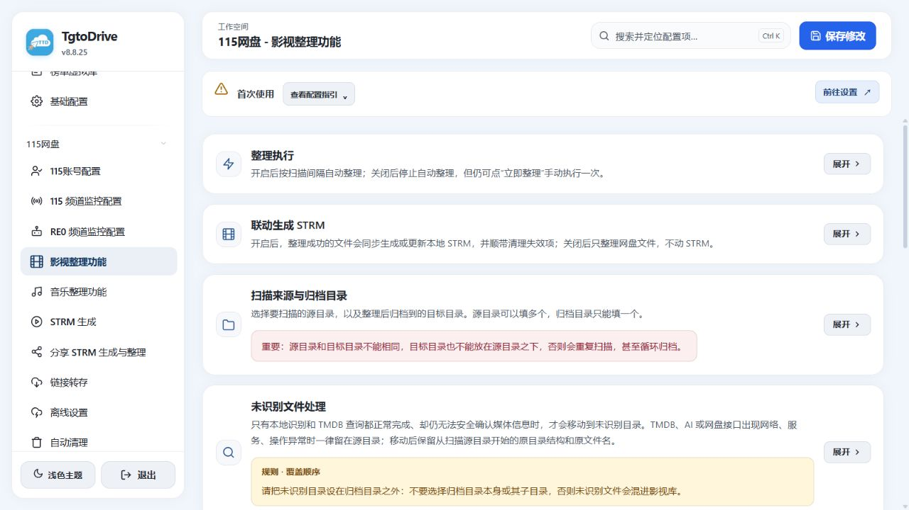
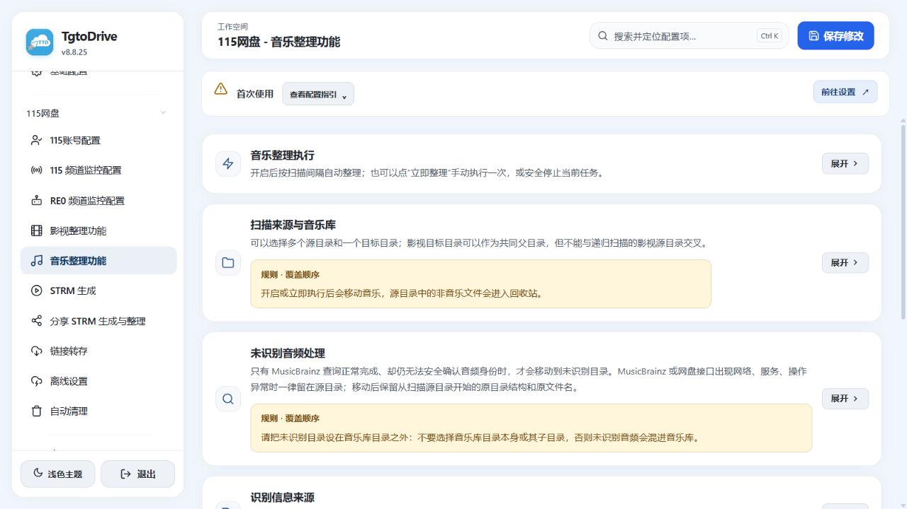
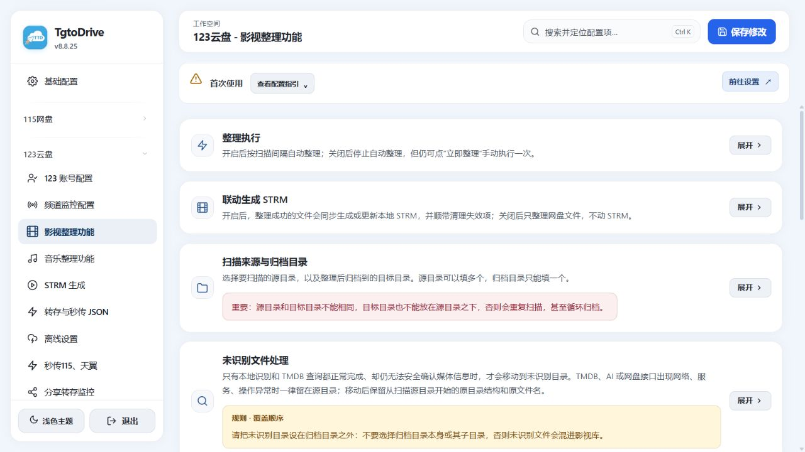
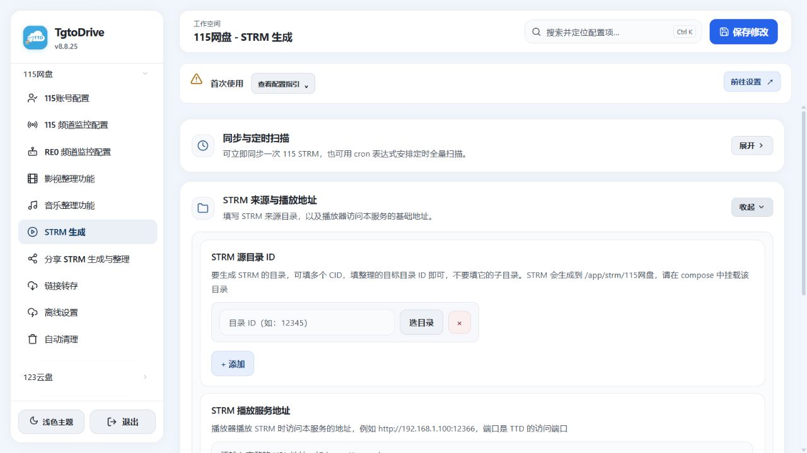
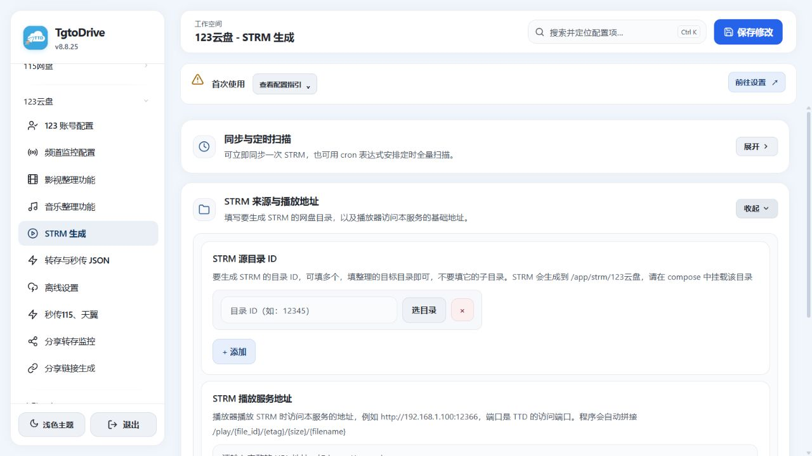
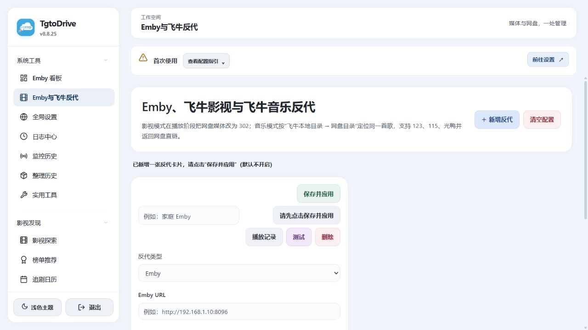
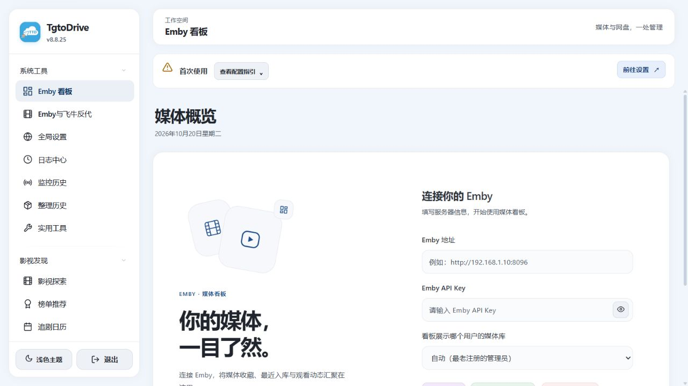
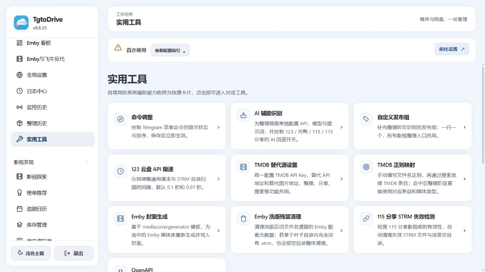

<p align="center">
  
</p>

<h1 align="center">TgtoDrive</h1>

<p align="center">
  <a href="https://hub.docker.com/r/walkingd/tgto123"></a>
  <a href="https://hub.docker.com/r/walkingd/tgto123"></a>
  
  
</p>

<p align="center"><a href="README.md">中文</a> · English</p>

<p align="center"><strong>Cloud-drive transfers and organization · STRM generation · Emby and Feiniu integration</strong></p>

For a detailed introduction, visit the [official website](https://www.tgtodrive.top).

[Docker image](https://hub.docker.com/r/walkingd/tgto123) · [Telegram community](https://telegram.me/TgtoDriveChat)

TgtoDrive is a cloud-drive file management tool you deploy with Docker. Connect your own drives to configure transfers, film/TV and music organization, STRM synchronization and media playback. Channel monitoring, inventory management, plugins and OpenAPI can be enabled as needed.

The software is free and will remain free. It does not provide movies, music or other content resources. Files, cloud-drive accounts and share links are supplied by the user.

## Features

| Feature | What it does |
| --- | --- |
| Share transfers and file import | Save shared files to selected cloud folders. Cross-drive fast import, JSON file lists and local-file fast import are available where supported by the provider. |
| Guangya GCID import | Generate or import GCID file lists. Connect PikPak or Xunlei accounts to process their shares and attempt fast import into Guangya. |
| Film/TV organization | Identify titles, seasons and episodes with TMDB; configure classification, naming, library folders, replacement preferences and multiple versions. Optionally update STRM files and notify Emby after organization. |
| Music organization | Identify music with MusicBrainz and organize it by region, artist, album and track. Configure audio metadata, handling of unidentified files and replacement preferences separately. |
| STRM generation | Build playback indexes from cloud folders, with manual synchronization, scheduled scans and incremental updates after organization. Sync subtitles and artwork as needed. 115 also has a separate share-based STRM workflow. |
| Emby and Feiniu proxy | Configure Emby, Feiniu Video or Feiniu Music proxies for HTTP 302 playback using cloud direct links. Feiniu Music maps local folders to cloud folders to locate the original tracks. |
| Media discovery | Browse title information, rankings and release calendars. Title details offer the currently available RE0, Guanying and SeedHub resource sources, with supported save or offline actions using your configured accounts. |
| Emby inventory | Synchronize library snapshots; filter titles, sources, missing episodes and multiple versions. Preview deduplication or cleanup and review protection rules before execution. [Inventory guide](docs/media-inventory.md) (Chinese) |
| Monitoring, schedules and notifications | Configure channel monitoring, keyword filters, folder routing, share-update monitoring and scheduled Telegram messages. Check monitoring history, organization history and logs for results. |
| Media and system tools | Emby dashboard, library covers, leftover metadata cleanup, expired 115 share-STRM checks, AI-assisted recognition, TMDB settings, API rate limits and connectivity checks. |
| Other features | SSH terminal, Pansou search, WeCom notifications, resource-community settings, local-file fast import and Bilibili video downloads, configured on their respective pages. |
| Python plugins | Import compatible single `.py` files or ZIP/PYZ, TAR, 7z and RAR packages. Run them through parameter forms and view results and logs; scheduling and AI development prompts are available. [Plugin guide](docs/toolbox-plugins.md) (Chinese) |
| GitHub plugin marketplace | Configure public catalogs, search for plugins, and install or update them from the Web console, with integrity checks, dependency checks and offline catalog caching. [Marketplace guide](docs/toolbox-marketplace.md) · [Repository template](plugin-marketplace-template/README.md) (Chinese) |
| OpenAPI | Create or revoke access tokens under **System Tools → Utilities → OpenAPI**. Search interface descriptions, download the specification and copy examples for scripts and plugins. [API guide](docs/openapi.md) (Chinese) |

## Supported Cloud Drives

| Drive | Main capabilities |
| --- | --- |
| 115 | Share transfers, film/TV and music organization, drive-based STRM, share-based STRM, offline tasks and file cleanup |
| 123 | Share transfers, file-list import, cross-drive fast import, film/TV and music organization, STRM, offline tasks and share monitoring |
| Guangya | Share transfers, GCID import, PikPak / Xunlei share import, film/TV and music organization, STRM and offline tasks |
| Tianyi | Share transfers, channel monitoring and scheduled file cleanup |

Features differ between providers; use the entries available in the current interface. Third-party services require your own accounts. RE0 unlocks use your own authorization and follow the upstream points rules.

## Screenshots

These screenshots show the v8.8.25 interface with empty demonstration settings. They contain no real accounts, credentials, private folders or viewing history. The interface shown is in Chinese; click an image to view it at full size.

### Film/TV and Music Organization



<details>
<summary>More screenshots: music, 123 organization, STRM, media integration and utilities</summary>

#### Music Organization



#### 123 Film/TV Organization



#### STRM Sources and Playback Address

| 115 | 123 |
| --- | --- |
|  |  |

#### Emby and Feiniu Proxy



#### Emby Dashboard Connection



#### Utilities



</details>

## Deploy with Docker Compose

### 1. Prepare the Folders

Use a NAS or Linux host with Docker 20.10+ and Docker Compose 2.x. The container needs access to the Telegram API if you use Telegram notifications or bot commands.

```bash
mkdir -p tgtodrive/db tgtodrive/strm
cd tgtodrive
```

### 2. Create `docker-compose.yml`

```yaml
version: '3'

services:
  tgtodrive-service:
    image: walkingd/tgto123:latest
    container_name: TgtoDrive
    network_mode: host  # Simplifies port access and direct-link playback
    environment:
      # Basic settings
      - TZ=Asia/Shanghai
      # Required: Web console login credentials
      - ENV_WEB_PASSPORT=admin
      - ENV_WEB_PASSWORD=password
    volumes:
      # Persist databases and logs at /app/db inside the container
      - ./db:/app/db
      # Replace the host path with your STRM folder, keeping /app/strm as the container path
      - /vol1/1000/Emby/strm:/app/strm
      # Optional: replace the host path with your personal files folder for local fast import
      - /path/to/local/files:/app/upload

    restart: always
```

Before starting, replace the example Web credentials and the host paths on the left side of the volume mappings. Set the credentials directly in the Compose `environment` section.

| Setting | What to enter |
| --- | --- |
| `ENV_WEB_PASSPORT` / `ENV_WEB_PASSWORD` | Your Web console username and a long password; replace `admin` and `password` |
| `./db:/app/db` | Persistent configuration, login state, databases and logs; keep this folder during updates and migration |
| `/vol1/1000/Emby/strm:/app/strm` | Replace the host path with your STRM output folder and keep `/app/strm` inside the container. Mount the same output in your media server |
| `/path/to/local/files:/app/upload` | A dedicated folder for local-file fast import; remove this volume mapping if you do not use the feature |

### 3. Start and Sign In

```bash
docker compose pull
docker compose up -d
docker compose ps
```

Open `http://YOUR_SERVER_IP:12366` in a browser and sign in with the Web credentials from your Compose file.

## Initial Setup

The menu labels below describe the corresponding Chinese pages shown in the screenshots.

| Step | Interface location | Action and check |
| --- | --- | --- |
| 1 | Your drive → Account settings | Connect your own account using the page's QR, SMS or password flow. Confirm that the folder picker can list your folders |
| 2 | System Tools → Global Settings | Configure a proxy and the main Telegram bot as needed. Send a test message if you want notifications |
| 3 | System Tools → Utilities | Enter the TMDB key in **TMDB Alternative Sources**. For AI fallback, configure **AI-assisted Recognition** and the switches for the relevant organizers |
| 4 | Your drive → Share Transfer / Transfer and JSON Import | Set the destination for each input type. Process a test share through an available interface action or your bot, then verify the saved files |
| 5 | Your drive → Film/TV Organization / Music Organization | Select source and library folders, set the rules, and manually process a few backed-up files. Check names, paths and retained versions |
| 6 | Your drive → STRM Generation | Select organized cloud folders, enter a service address reachable by the player, synchronize manually and play a test file |
| 7 | System Tools → Emby and Feiniu Proxy | Enter the upstream address, connection details and listen port for the selected service. Save and enable the proxy, then connect clients to its port |
| 8 | The relevant monitoring or schedule page | Enable channel monitoring, scheduled organization or synchronization after manual checks pass. Review history and logs |

For Xunlei shares imported into Guangya, open **Guangya → JSON, PikPak and Xunlei Import** (`秒传JSON、PP与迅雷`). Sign in to Xunlei, select the Xunlei import destination, and send a valid share link to your bot, including its extraction code when required.

For detailed page introductions and instructions, visit the [official website](https://www.tgtodrive.top).

## Usage Notes

- **Folder boundaries:** Source and library folders must not be identical or nested. Keep music sources outside film/TV scan trees, and place unidentified-file folders outside the final libraries.
- **Music staging:** Non-music files are moved to the cloud recycle bin. Unidentified audio stays in place or moves to a separate folder according to the switch. Music organization itself does not generate STRM files.
- **STRM and originals:** STRM files are playback indexes. The original cloud files or shares must remain available; synchronized subtitles and artwork consume local storage.
- **Addresses and paths:** Verify playback addresses from the player's device. `localhost` refers to the caller itself. Path mappings connect TgtoDrive container paths on the left to media-server container paths on the right, pointing to the same content.
- **Proxy ports:** Host networking uses the configured listen ports directly. With bridge networking, map the Web port and every proxy port you actually use.
- **Feiniu Music:** Playback uses original cloud files. Local and cloud folders need matching tracks; there is no fallback to NAS transcoding.
- **Cleanup and replacement:** Organizer replacement, cleanup and linked inventory operations affect real files. Test with backed-up samples and review previews where provided.
- **Emby Connect:** The Emby proxy blocks `/Connect/Exchange` by default. Local account login and playback remain available. See the [deployment and verification guide](docs/emby-connect-exchange-protection.md) (Chinese).

## Updates and Backups

```bash
# Follow recent logs
docker compose logs -f --tail=100

# Pull and apply a new image
docker compose pull
docker compose up -d

# Stop and start the existing container
docker compose stop
docker compose start
```

Keep `docker-compose.yml`, `db/` and the actual STRM output folder before updating. Stop the container before copying runtime data, or use a backup method that guarantees database consistency. Copying only an active SQLite main file can miss pending transactions.

Reuse the persistent folders when migrating. After an update, check Web login, cloud folder access, task state and playback. `docker compose restart` only restarts the existing container; it does not apply a newly pulled image.

## Project and Scope

Only manage files you own or are authorized to use, and follow the relevant service terms. Free software does not make cloud-drive, media-server or other third-party services free.

Report issues in the [Telegram community](https://telegram.me/TgtoDriveChat). Include reproduction steps, relevant versions and necessary logs after removing accounts, tokens, cookies, private paths and share extraction codes.

If TgtoDrive helps you, a Star is welcome.
